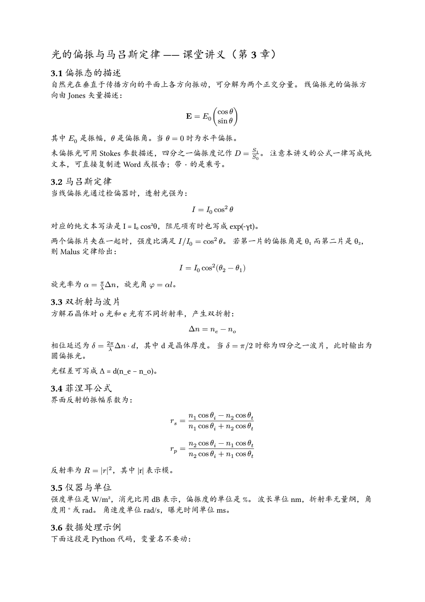
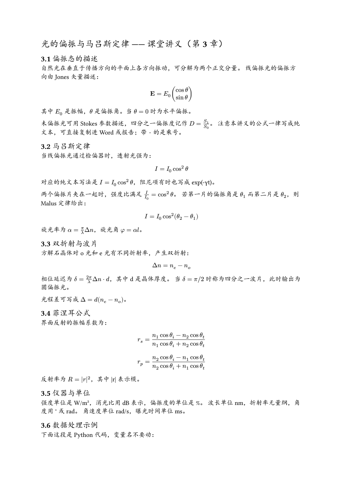

# formula-typesetting

把 AI 生成的 **Unicode 伪公式**转成 LaTeX 源码，并渲染成 PDF / DOCX / PPTX 里的**真公式**。

不是图片，不是豆腐块，不是 `e^(−γt)` 这种脱字符冒充上标 —— 是**双击能进公式编辑器**的原生公式。

| 伪公式（AI 默认写法） | 本工具产出 |
|---|---|
| `e^(−γt)` | `e^{-\gamma t}` |
| `ω_d` | `\omega_{d}` |
| `ε/R` | `\frac{\varepsilon}{R}` |
| `√(k/m)` | `\sqrt{\frac{k}{m}}` |
| `m·ẍ` | `m \cdot \ddot{x}` |
| `A₀` | `A_{0}` |

---

## 为什么需要它

大模型写公式时默认写 Unicode 伪公式，因为**它看起来像**。实测一条真实生成链路
（讲义 + 课件 + 构建脚本）grep `latex|katex|mathml|omml` **零命中**，
评测报告自己也写着「源文件没有任何公式」。

⇒ **问题不在渲染器，在源。** 换渲染器、换公式库都没用，必须先把源改成 LaTeX。

这个 skill 做的就是这个：**检测 → 规范化 → 渲染 → 验收**，一条链走完。

<p align="center">
  
  
</p>

*上：同一份讲义。改造后 `I/I_0` 成了带分数线的真分式，`θ₁` 成了真下标，
`|I0_meas − I0_fit|` 的下标也对了。注意 `W/m²` 这类**量纲没被误改**成公式。*

---

## 它做什么

| 步骤 | 动作 | 关键约束 |
|---|---|---|
| 1 | 判定问题在**源**还是在渲染器 | 源里没有 LaTeX ⇒ 换渲染器无用 |
| 2 | `scan` 只报告，不改 | 先建立基线：多少处、分布在哪 |
| 3 | `fix` 产出**副本** + 逐条对照报告 | 源文件一字不改；置信度分三层 |
| 4 | `validate` 实测管线能否渲染 | 缺工具**如实标 skipped**，不假装验证过 |
| 5 | PPTX 注入原生可编辑公式 | 注入前校验形状数，防静默删形状 |

### 三层置信度

- **A 类**（整行公式）→ 直接改写
- **B 类**（正文内带结构信号的行内公式）→ 改写
- **C 类**（单个裸变量）→ **只报告，不改**（误伤风险太高）

另有 8 条**误报防线**，每条都对应实测踩过的坑：量纲（`rad/s`、`N·s/m`）不是分式；
代码块不是公式；`numpy / scipy` 是模块名不是分式；标题行更严判定；中文夹变量单列处理……

---

## 安装

### 1. GitHub CLI（推荐）

```bash
gh skill install 242742532Celestia/formula-typesetting formula-typesetting
```

### 2. 手动 clone

```bash
git clone https://github.com/242742532Celestia/formula-typesetting.git
cp -R formula-typesetting/skills/formula-typesetting ~/.claude/skills/
# 或项目级：cp -R formula-typesetting/skills/formula-typesetting .claude/skills/
```

### 3. 挂载仓库（Claude Managed Agents）

仓库根的 `.claude/skills/` 布局会在 session 启动时自动被发现。

---

## 依赖

| 依赖 | 必需性 | 缺了会怎样 |
|---|---|---|
| Python 3.9+ | **必需** | — |
| pandoc | 强烈建议 | `validate` 标 `skipped`（退出码 2），其余功能正常 |
| typst | 可选 | 只影响「渲染 PDF 验收」这一步 |

```bash
# pandoc: https://pandoc.org/installing.html
# typst:  https://typst.app/
```

> `validate` 的退出码有三态，**「没验证」不算「验证过了」**：
> `0` = 跑过且通过 / `1` = 跑过但失败 / `2` = 根本没跑（缺工具）。

---

## 快速上手

```bash
cd skills/formula-typesetting

# ① 看看有多少伪公式（只报告，不改）
python scripts/formula_norm.py scan 讲义.md

# ② 产出副本 + 逐条对照报告（源文件不动）
python scripts/formula_norm.py fix 讲义.md --out 讲义_规范化.md --report 对照报告.md

# ③ 实测能不能渲染成真公式
python scripts/formula_norm.py validate 讲义_规范化.md

# ④ 回归自测
python scripts/formula_norm.py selftest
```

PPTX 注入：

```bash
# 先看 deck 里有哪些文本（用来写 spec）
python scripts/pptx_omml_inject.py --scan 课件.pptx

# 按 spec 注入，产出新文件
python scripts/pptx_omml_inject.py 课件.pptx 课件_公式版.pptx --spec spec.json
```

---

## ⚠️ PPTX 侧的三条铁律

PPTX 的公式要能双击进编辑器，必须注入 OMML（`<a14:m>`）。这里有三条**踩过就废**的约束：

1. **`a:p` 的子元素顺序**必须是 `pPr, (r|br|fld|a14:m)*, endParaRPr`
   ⇒ 只能**就地替换** `<a:r>`。顺序错 ⇒ PowerPoint「修复」文件并**无声删掉整个形状**
   —— 不报错、不提示，用户只会发现内容凭空少了。
2. **`m:r` 内部顺序**是 `m:rPr, a:rPr, m:t`；拼 `a:rPr` 必须**整段拼好再闭合**，
   否则游离的 `/>` 会被当字面量渲染出来（满屏 `/>`）。
3. **一行一个公式用 inline `m:oMath`**，别用 `m:oMathPara`（PowerPoint 会合并相邻的）。

**注入前后必须比对形状数。** 本工具的 `pptx_omml_inject.py` 自带这道守卫
（形状数或 XML 良构性一变就报错、不写文件）——坏文件比没有文件更糟。

---

## 已验证的边界

| 场景 | 实测结果 |
|---|---|
| 真实课件（32 页）注入 5 处公式 | slide10 形状 12→12、slide11 19→19，`cNvPr` 集合一致 |
| PowerPoint 实开 | 32 页，**无修复提示**，文字抽取出现数学斜体（`𝑚 𝑥 +𝑐 𝑥 +𝑘𝑥=0`） |
| 5 份讲义/教案材料 | **227 处**伪公式，仅 **1 处**需人工复核（0.4%） |
| 单元级回归 | 18/18 通过 |
| 文档级回归 | 8/8 通过 |
| 无 pandoc 环境 | 退出码 2 + `not_verified: true`，**不崩溃** |
| 跨平台 | 两脚本非 ASCII 标识符 0 个；CI 覆盖 win/mac/linux |

---

## 已知限制

- **pandoc 的 typst writer 对个别命令有损**：实测 `\begin{pmatrix}` 会被压成 `vec(...)`。
  矩阵/对齐环境多的文档，渲染后要**用眼睛核对一遍**。
- **围栏内的多行结构**（`\begin{pmatrix}`、`\begin{aligned}`）只做规范化，不改写内部 ——
  这类结构里的下标不会被补成 `_{...}`。
- **`validate` 只验管线，不验内容**。它跑通 pandoc/typst/docx 就报 `ok`，
  但一份把公式整段吃掉的坏文档同样能通过。**必须再查渲染产物里的字面量残留**
  （`$$` / `\frac` / `\theta`），并把 PDF 转成 PNG **用眼睛看一遍**。
- `validate` **不检查代码块围栏是否保留** —— 这条由文档级回归 D5 覆盖，
  但改脚本后请自己跑一遍 `selftest`。

---

## 仓库结构

```
formula-typesetting/
├── README.md
├── LICENSE                          MIT
├── .gitignore
├── .github/workflows/ci.yml         跨平台回归自测
├── docs/                            before / after 对比图
├── skills/formula-typesetting/      ← skill 本体
│   ├── SKILL.md
│   ├── references/
│   │   ├── writing-convention.md    LaTeX 书写规范（Do/Don't 对照表）
│   │   └── omml-injection.md        PPTX 注入配方与三条铁律
│   └── scripts/
│       ├── formula_norm.py          检测 / 改造 / 验收
│       └── pptx_omml_inject.py      PPTX 注入 OMML
└── tests/
    └── eval_input_偏振讲义.md        eval 用素材（与开发素材无关）
```

---

## 对 Agent 的额外提示

`SKILL.md` 里写清了几条**别的 skill 不会写**的东西：

- `validate` 返回 `ok: true` **不等于**公式是对的；
- 报告里带「需复核」的条目必须**逐条看过再采纳**；
- 源里已有一部分 LaTeX 时，**已有围栏不重包**（再包一层会变嵌套 display math，
  渲染时整段公式消失）；
- 代码块围栏被吞 ⇒ 代码块变正文 ⇒ 变量名的 `_`、`*` 被转义 ⇒ **代码直接被改坏**。

这四条都是**静默破坏**：不报错、不提示，只在渲染或阅读时才发现。

---

## License

MIT，见 [LICENSE](LICENSE)。
